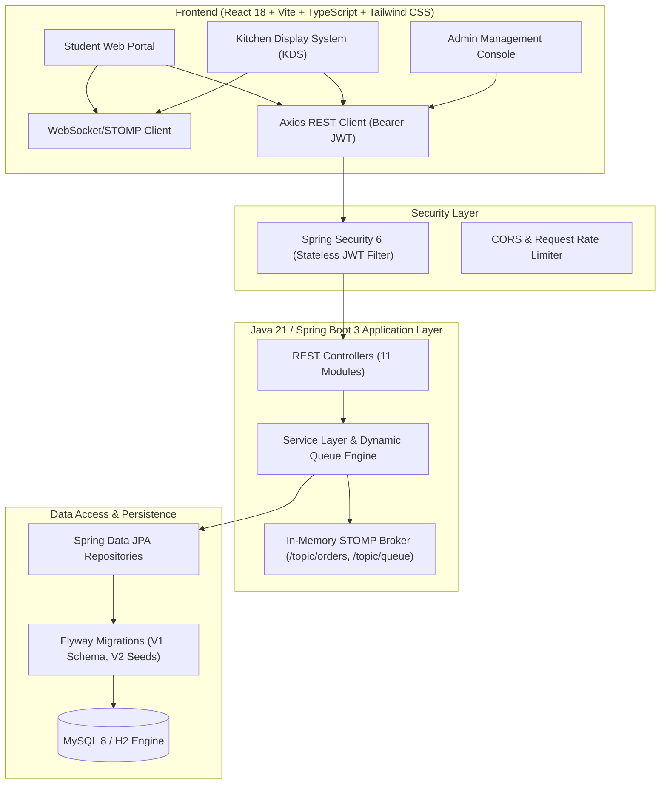
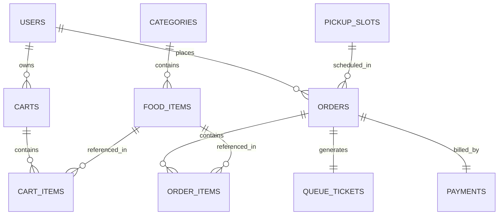

# Smart Canteen Pre-Order and Queue Management System

A production-grade, database-connected Java full-stack web application designed for campus food courts and engineering canteens. Built with **Java 21**, **Spring Boot 3.3.4**, **MySQL 8** (with instant H2 zero-setup mode), **Flyway migrations**, **Spring Security (JWT)**, **STOMP WebSockets**, and a modern **React 18 + Vite + TypeScript + Tailwind CSS** frontend.

---

## 1. Key Features & Role Capabilities

### 👨‍🎓 Student Portal
- **Browse & Filter Menu**: Search dishes by keyword, category, and vegetarian-only filter.
- **Cart Management**: Add items with custom quantities, real-time bill calculations (with 5% GST), and stock checks.
- **Pre-Order Recess Slots**: Reserve time-limited pickup slots (e.g., 12:30–13:30) with atomic slot capacity enforcement.
- **Digital Queue Ticket**: Monotonically assigned alphanumeric ticket (e.g., `TKT-101`) with dynamic wait-time calculation.
- **Live Queue Tracking**: Real-time position tracking and countdown through WebSocket broadcasts.
- **Order History & Receipts**: View itemized receipts and cancel eligible orders before kitchen preparation begins.
- **Simulated Payment Gateway**: Supports simulated Online UPI (GPay/PhonePe), Card/NetBanking, and Cash on Pickup.

### 👨‍🍳 Kitchen Staff (KDS)
- **Real-Time Preparation Board**: Interactive 4-stage Kanban board (*Incoming / Placed* → *Accepted* → *Cooking / Preparing* → *Ready for Pickup* → *Collected*).
- **1-Click Status Transitions**: Instantly triggers automated queue recalculations and pushes live notifications to students.
- **Order Kitchen Notes**: View special student instructions (e.g., *"Less spicy"*, *"No onions"*).
- **Kitchen Operational Metrics**: Live counts of pending, cooking, and ready orders.

### 🛡️ Administrator Suite
- **Analytics Dashboard**: Today's revenue, lifetime sales, active pipeline workload, cancellation rate, and popular items.
- **Food Menu CRUD**: Add, edit, adjust prices, manage stock inventory, and toggle active status.
- **Category Management**: Create, reorder, and configure food categories.
- **User Management**: Inspect all registered campus accounts and toggle enable/disable statuses.
- **Order Management**: Audit all campus orders with status, date, and keyword filters.
- **Pickup Slot Scheduling**: Configure pickup windows, adjust maximum capacities, and monitor bookings.
- **Sales Reports & CSV Export**: Date-range filtered sales summaries and one-click downloadable CSV reports.
- **Administrative Audit Logs**: Track all admin actions with timestamps, entity IDs, and remote IP addresses.

---

## 2. System Architecture



---

## 3. Database Design & Entity Relationships

The schema is managed declaratively via Flyway migrations (`V1__init_schema.sql`, `V2__seed_data.sql`):



- **Financial Precision**: All currency fields (`price`, `subtotal`, `tax`, `total_amount`) use `DECIMAL(10,2)` mapped to `java.math.BigDecimal`.
- **Atomic Operations**: Atomic stock deduction and atomic pickup slot capacity reservations protect against race conditions.

---

## 4. Default Demo Accounts

All demo accounts are pre-seeded and ready for instant login:

| Role | Username | Password | Purpose |
| :--- | :--- | :--- | :--- |
| **Student** | `student` | `Password@123` | Browsing menu, cart, checkout, live queue |
| **Kitchen Staff** | `kitchen` | `Password@123` | Kitchen Preparation Board & KDS operations |
| **Administrator** | `admin` | `Password@123` | Analytics, Menu CRUD, Users, Reports |
| **Student 2** | `student2` | `Password@123` | Multi-user concurrent testing |

---

## 5. Quick Start Instructions

### Prerequisites
- **Java 21 LTS** installed (`java -version`)
- **Node.js 18+** & npm (`node -v`, `npm -v`)
- *(Optional)* MySQL 8 (Project runs out-of-the-box with H2 in MySQL mode by default)

### Option A: Running with Default Zero-Configuration (Recommended)

1. **Start the Java Spring Boot Backend**:
   ```bash
   cd backend
   .\mvnw.cmd spring-boot:run
   ```
   *The backend starts on `http://localhost:8080`, automatically executes Flyway migrations, and seeds initial menu items and demo accounts.*

2. **Start the React Frontend**:
   ```bash
   cd frontend
   npm run dev
   ```
   *The frontend starts on `http://localhost:5173`. Open in your browser!*

---

### Option B: Running with Local MySQL 8 Server

1. **Create the Database in MySQL**:
   ```sql
   CREATE DATABASE smart_canteen_db CHARACTER SET utf8mb4 COLLATE utf8mb4_unicode_ci;
   ```

2. **Set Environment Variables (or edit `backend/src/main/resources/application-mysql.properties`)**:
   ```bash
   set DB_HOST=localhost
   set DB_PORT=3306
   set DB_NAME=smart_canteen_db
   set DB_USERNAME=root
   set DB_PASSWORD=your_password
   ```

3. **Start the Backend with the MySQL profile**:
   ```bash
   cd backend
   .\mvnw.cmd spring-boot:run -Dspring-boot.run.profiles=mysql
   ```

4. **Start the Frontend**:
   ```bash
   cd frontend
   npm run dev
   ```

---

## 6. Running Automated Tests & Builds

### Backend Automated Tests (JUnit 5, Mockito, Spring Boot Test)
```bash
cd backend
.\mvnw.cmd clean test
```
*Executes all 12 test suites covering authentication, menu operations, dynamic queue wait-time calculations, transactional pre-orders, and context loading.*

### Frontend Tests (Vitest) & Production Build
```bash
cd frontend
npm run test
npm run build
```
*Validates all TypeScript interfaces, component test suites, and bundles the production distribution with zero errors.*

---

## 7. REST API Endpoints Overview

| Method | Endpoint | Access | Description |
| :--- | :--- | :--- | :--- |
| `POST` | `/api/auth/login` | Public | Authenticate user & issue JWT |
| `POST` | `/api/auth/register` | Public | Register new student account |
| `GET` | `/api/auth/me` | Authenticated | Retrieve current user profile |
| `GET` | `/api/menu` | Public | Search food items with category and veg filters |
| `GET` | `/api/categories` | Public | List active food categories |
| `GET` | `/api/cart` | Student | View current shopping cart |
| `POST` | `/api/cart/items` | Student | Add food item to cart |
| `GET` | `/api/pickup-slots` | Public | List available pickup windows with capacity |
| `POST` | `/api/orders` | Student | Place pre-order & allocate queue ticket |
| `GET` | `/api/orders/my` | Student | View order history and status |
| `POST` | `/api/orders/{id}/cancel` | Student | Cancel eligible pre-order |
| `GET` | `/api/queue/status` | Public | Live queue counts and active tickets |
| `GET` | `/api/kitchen/orders` | Kitchen/Admin | View active incoming tickets |
| `PATCH` | `/api/kitchen/orders/{id}/status`| Kitchen/Admin | Advance order status in preparation board |
| `GET` | `/api/admin/dashboard` | Admin | Overall sales & queue KPIs |
| `POST` | `/api/admin/menu` | Admin | Create new food item |
| `GET` | `/api/admin/reports/export` | Admin | Download sales report as CSV |

---

## 8. Smart Queue Wait Time Algorithm

$$\text{EstimatedWait}(O_k) = \left\lceil \frac{\sum_{j < k} T_{\text{active}}(O_j)}{C} + T_{\text{base}}(O_k) \right\rceil$$

Where:
- $T_{\text{base}}(O_k) = \max_{i \in O_k}(P_i) + \sum (q_i - 1) \times 1.5\text{ min}$
- $C = \text{Concurrent kitchen cooking stations (default: 2)}$
- $T_{\text{active}} = \text{Remaining preparation duration of active preceding orders}$

When orders transition states on the Kitchen Preparation Board, the queue positions automatically recalculate and broadcast in real time across active clients over STOMP WebSockets.
# Smart-Canteen-Pre-Order-and-Queue-Management-System-Using-Java

