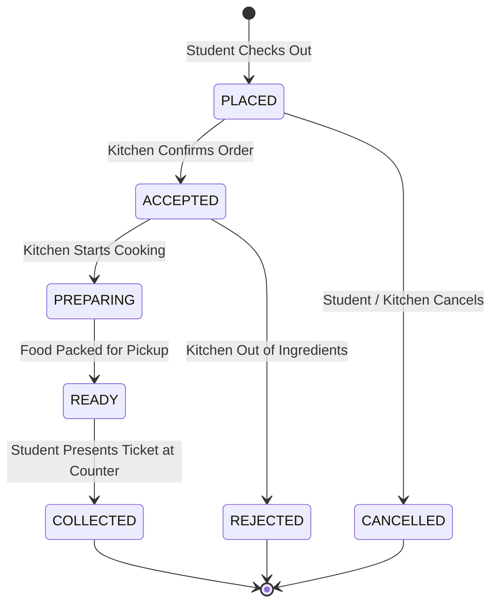

# System Architecture Documentation

## Smart Canteen Pre-Order & Queue Management System

### 1. High-Level System Architecture Diagram

```mermaid
graph TD
    subgraph Frontend ["Frontend (React 18 + Vite + TypeScript + Tailwind CSS)"]
        UI_STUDENT["Student Web Portal (Menu, Cart, Pre-Order, Live Tracker)"]
        UI_KITCHEN["Kitchen Display System (KDS / Order Preparation Board)"]
        UI_ADMIN["Admin Dashboard (Analytics, Menu, Users, Slots, Reports)"]
        STOMP_CLIENT["WebSocket/STOMP Client (Real-time Live Sync)"]
        AXIOS_CLIENT["Axios REST Client (JWT Interceptor)"]
    end

    subgraph Gateway_Security ["Security & API Gateway Layer"]
        SPRING_SEC["Spring Security 6 (Stateless JWT Filter)"]
        CORS_FILTER["CORS & Request Rate Limiter"]
        ROLE_AUTH["Role-Based Access Control (@PreAuthorize)"]
    end

    subgraph Backend_App ["Java 21 / Spring Boot 3 Application Layer"]
        subgraph Controllers ["REST Controller Layer"]
            C_AUTH["AuthController"]
            C_MENU["MenuController & CategoryController"]
            C_CART["CartController"]
            C_ORDER["OrderController"]
            C_QUEUE["QueueController"]
            C_KITCHEN["KitchenController"]
            C_ADMIN["AdminController"]
            C_PAYMENT["PaymentController"]
            C_SLOT["PickupSlotController"]
            C_REPORT["ReportController"]
        end

        subgraph Services ["Service Layer (Business Logic & Transactions)"]
            S_AUTH["AuthService & UserDetailsService"]
            S_MENU["MenuService & CategoryService"]
            S_CART["CartService"]
            S_ORDER["OrderService (Transactional Stock & Slots)"]
            S_QUEUE["QueueService (Dynamic Wait-Time Engine)"]
            S_KITCHEN["KitchenService"]
            S_PAYMENT["PaymentService (Mock Gateway & Cash)"]
            S_SLOT["PickupSlotService"]
            S_NOTIF["NotificationService & WebSocketPublisher"]
            S_AUDIT["AuditLogService"]
            S_REPORT["ReportService (Aggregations & CSV Export)"]
        end

        subgraph WebSocketBroker ["Real-Time Messaging"]
            STOMP_BROKER["In-Memory STOMP Broker (/topic/orders, /topic/queue)"]
        end
    end

    subgraph DataAccessLayer ["Spring Data JPA & Hibernate"]
        REPOS["JPA Repositories (Locking, Pagination, Custom Queries)"]
    end

    subgraph DatabaseLayer ["Persistence & Migrations"]
        MIGRATION["Flyway Migrations (V1 Schema, V2 Seeds)"]
        MYSQL_DB[("MySQL 8 Database / H2 Compatibility Engine")]
    end

    UI_STUDENT --> AXIOS_CLIENT
    UI_KITCHEN --> AXIOS_CLIENT
    UI_ADMIN --> AXIOS_CLIENT
    UI_STUDENT --> STOMP_CLIENT
    UI_KITCHEN --> STOMP_CLIENT

    AXIOS_CLIENT --> SPRING_SEC
    SPRING_SEC --> CORS_FILTER
    CORS_FILTER --> ROLE_AUTH
    ROLE_AUTH --> Controllers

    STOMP_CLIENT <--> STOMP_BROKER

    Controllers --> Services
    Services --> WebSocketBroker
    Services --> REPOS
    REPOS --> MIGRATION
    MIGRATION --> MYSQL_DB
```

---

### 2. Smart Queue Management Algorithm

The core innovation of the Smart Canteen is its **dynamic workload-aware preparation & queue estimation algorithm**:

1. **Ticket Number Generation**:
   - Each order gets an alphanumeric ticket code (e.g., `TKT-101`, `TKT-102`), strictly unique per day and monotonically ascending.
   - Database unique index combined with synchronized/transaction-safe ticket sequence assignment prevents duplicates during concurrent traffic spikes.

2. **Wait Time Calculation Model**:
   - Each food item has a calibrated `preparation_time_minutes` attribute $P_i$.
   - For an individual order $O_k$ containing items with quantities $q_i$, the base preparation duration is:
     $$T_{\text{base}}(O_k) = \max_{i \in O_k}(P_i) + \sum_{i \in O_k}(q_i - 1) \times 1.5 \text{ min}$$
   - **Active Kitchen Workload Pipeline**:
     The kitchen has a defined concurrency throughput capacity $C$ (number of concurrent preparation stations, default = 2).
     For all pending orders $O_j$ in state `ACCEPTED` or `PREPARING` placed before $O_k$:
     $$W_{\text{active}} = \frac{\sum_{j < k} T_{\text{remaining}}(O_j)}{C}$$
   - **Dynamic Queue Wait Time**:
     $$\text{EstimatedWait}(O_k) = \lceil W_{\text{active}} + T_{\text{base}}(O_k) \rceil$$
   - When an order transitions to `READY` or `COLLECTED`, active queue positions for subsequent waiting tickets recalculate dynamically, sending STOMP WebSocket broadcasts.

---

### 3. Order Lifecycle State Machine

---

### 4. Security Architecture

1. **Authentication**:
   - JWT tokens generated upon valid credentials check with BCrypt (12 rounds).
   - Claims include `sub` (username), `userId`, `roles`, `exp`, `iat`.
   - Token sent in `Authorization: Bearer <token>` header.
2. **Role-Based Access Control (RBAC)**:
   - `ROLE_STUDENT`: Browse menu, manage own cart, create orders, view own queue tickets, cancel own eligible orders.
   - `ROLE_KITCHEN_STAFF`: Access kitchen prep board, accept/prepare/ready/collect orders, view kitchen workload.
   - `ROLE_ADMIN`: Full administrative control (menu CRUD, user management, slot configuration, analytics, audit log view).
3. **Data Integrity & Concurrency**:
   - Pessimistic/Optimistic checks for inventory stock deduction.
   - Pickup slot capacity checks (`current_booked_count < max_orders_capacity`).
   - Idempotent order placement safeguards preventing double submits.
