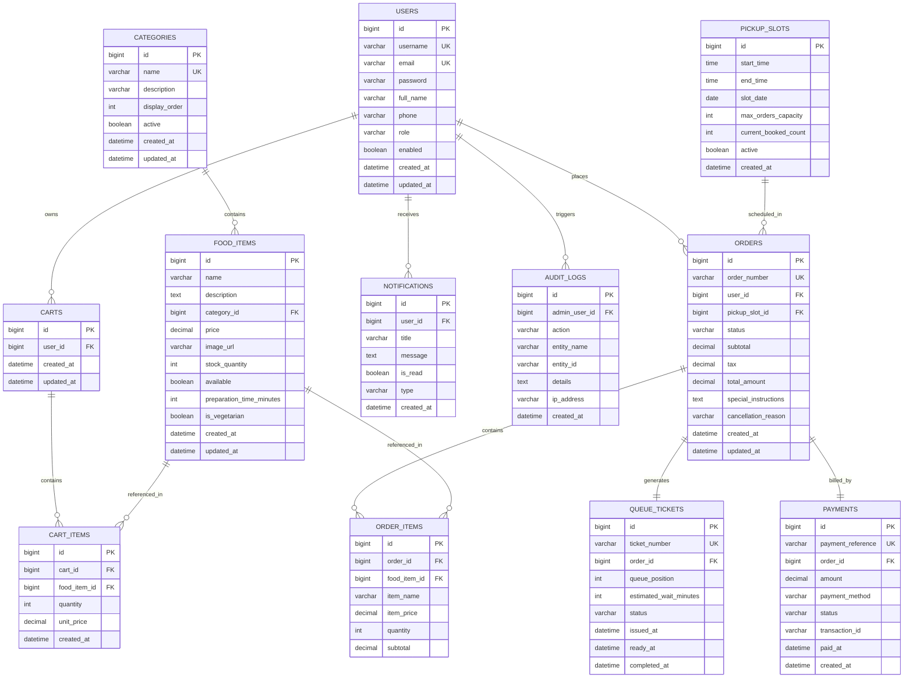

# Database Design & Schema Specification

## 1. Entity-Relationship (ER) Diagram

---

## 2. Table Specifications & Constraints

- **Monetary Precision**: All currency values (`price`, `subtotal`, `tax`, `total_amount`, `unit_price`, `item_price`, `amount`) strictly use `DECIMAL(10,2)` mapped to Java `java.math.BigDecimal` to eliminate floating-point rounding errors.
- **Transactional Integrity**:
  - `orders.order_number` and `queue_tickets.ticket_number` have unique database constraints (`UK`).
  - `pickup_slots.current_booked_count` is updated atomically within transactional isolation.
  - `food_items.stock_quantity` uses atomic decrements to avoid race conditions.
